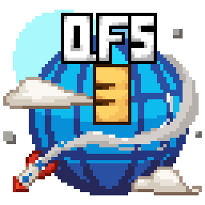

<!--
  Discord invites on this page MUST stay https://discord.gg/NM4zYptd7V.
  Every platform gets its own permanent invite code so the Discord owner channel shows where each
  member came from; NM4zYptd7V is the GitHub one. The website uses UwzA6C23Xu, Twitch PCkkvJMHKc,
  and so on. Pasting a different code here does not break anything visibly - it silently
  misattributes every join that came from this repo.

  The join card is OURS, served from qfs-site (src/pages/api/discord-card.svg.ts). The upstream
  README used invidget.switchblade.xyz, which is now dead and rendered as a broken image; Discord's
  own widget.png works but only reports the online count and looks ancient. Ours shows online AND
  total members, and falls back to a cached snapshot if Discord or the box is unreachable.
-->
<p align="center"></p>

<h1 align="center">QFS3 Launcher</h1>

<p align="center">The official launcher for <b>QFS3 Island</b>, a multilingual QSMP fan Minecraft server.</p>

<p align="center">
  
  
  
  
</p>

<p align="center">
  <a href="https://www.qsmpfansrv.com">Website</a> ·
  <a href="https://www.qsmpfansrv.com/map">Live map</a> ·
  <a href="https://www.qsmpfansrv.com/leaderboards">Leaderboards</a> ·
  <a href="https://discord.gg/NM4zYptd7V">Discord</a>
</p>

<p align="center">
  <a href="https://discord.gg/NM4zYptd7V">
    
  </a>
</p>

---

## What it is

One click to play on QFS3. The launcher installs the modpack, keeps it in sync, sorts out the right
Java runtime, and hands the game off to Prism Launcher to actually run.

Around that, it carries the parts of the community that used to live only on the website: news,
events, the screenshot gallery, who is streaming right now, and your skins. You do not need to have
Java installed, and you do not need to touch a mods folder.

---

## Features

### Playing

- **One-click launch.** The modpack lives in a Prism-managed instance; accounts and profiles are
  handled there, so nothing is duplicated.
- **Modpack sync with integrity checking.** Every downloaded file is verified against the manifest's
  SHA-1 before it is put in place. A bad file is retried, then left out rather than blocking play.
- **Automatic Java.** The correct runtime is installed for you, and a wrong or wrong-architecture
  Java is detected and repaired. Recovery packs handle the cases a normal install cannot.
- **Repair Mods.** Rebuilds the modpack in place when something has gone wrong locally.
- **Live server status** with the current online player count, right on the home screen.
- **RAM slider** that stays in sync with the Prism instance.

### Community

- **Streamers.** Live Islanders appear on the home screen the moment they go live, with the stream
  title and category. Hover for the stream preview. Every streamer channel is listed even when
  they are offline, so you can follow them any time.
- **News.** The changelog and announcement feed, published from the QFS3 website and read in the
  launcher, with an unread indicator.
- **Events.** Server events with live countdowns, plus community events you can create from the
  launcher and have mirrored to Discord.
- **Gallery.** Community screenshots as grouped multi-image posts with an in-launcher lightbox and
  likes that sync with the website. Upload your own, edit or delete your posts.
- **Avatar.** Skin and cape management with a posed 3D preview, custom groups, drag-and-drop
  upload, search, and a per-account backup of the skin you had before.
- **Map and Leaderboards** shortcuts straight to the live island map and the player rankings.
- **Discord linking**, so your launcher and your Discord account know about each other.

### Under the hood

- **Automatic updates** through GitHub Releases. Windows and Linux update in place; macOS ships a
  signed disk image.
- **Five languages**: English, Spanish, Portuguese, French and Polish.
- **Crash capture.** Crash logs are sanitised before they are ever sent, so a support report never
  carries your machine name or paths.
- **Per-platform JVM tuning**, versioned so flags can be corrected for existing installs without
  resetting anything the player chose.

This is not an exhaustive list. Install it and have a look around.

---

## Download

Grab the latest build from [Releases](../../../releases) and pick the installer for your system.

| Platform | File |
| -------- | ---- |
| Windows x64 | `QFS3-Launcher-<version>-win-x64.exe` |
| macOS (Intel + Apple Silicon) | `QFS3-Launcher-<version>-mac-universal.dmg` |
| Linux x64 | `QFS3-Launcher-<version>-linux-x86_64.AppImage` |

---

## Building from source

```bash
npm install
npm start        # run in development
npm run build    # produce installers for the current platform
```

Node 20 or newer. `npm run build` writes to `dist/`.

---

## Credits and licence

QFS3 Launcher is a fork of the [Selvania Launcher](https://github.com/luuxis/Selvania-Launcher) by
**Luuxis**, and it has been rebuilt substantially since: the Prism handoff, the modpack pipeline,
the whole community side (news, events, gallery, streamers, avatar), the translations and the
update flow are QFS3's own work. The launcher core it grew out of is still Luuxis's, and the credit
below is required by the licence that came with it.

Licensed under the **Luuxis License v1.0**. See [LICENSE](../LICENSE.md) for the full text in
French and English. In short, and binding on anyone forking this in turn:

- The source of any redistributed or modified version must stay public and freely accessible.
- Luuxis must be credited as the original author.
- The licence must be kept as-is. It cannot be altered, replaced or removed.
- The code itself may not be sold or commercially redistributed.
